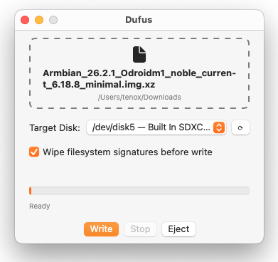

# Dufus

A GUI disk image writer for macOS. For when you're tired of `dd`.

Dynamically decrompresses `.gz`, `.xz`, `.bz2` and `.lz` on the fly.

## Password prompts

macOS asks for an admin password to write a raw disk, and asks again after 5 minutes.
To stop this, choose **Dufus > Install Disk Helper…** once. It installs a small setuid
helper in `/Library/PrivilegedHelperTools` that opens disks for Dufus without a prompt.
It only opens removable media (SD/CF cards, most USB sticks) with no mounted volumes,
and only for admin users running the signed Dufus app. Fixed disks (internal, external
HDD/SSD, Time Machine) still ask for the password. Remove it with **Uninstall Disk Helper…**.
